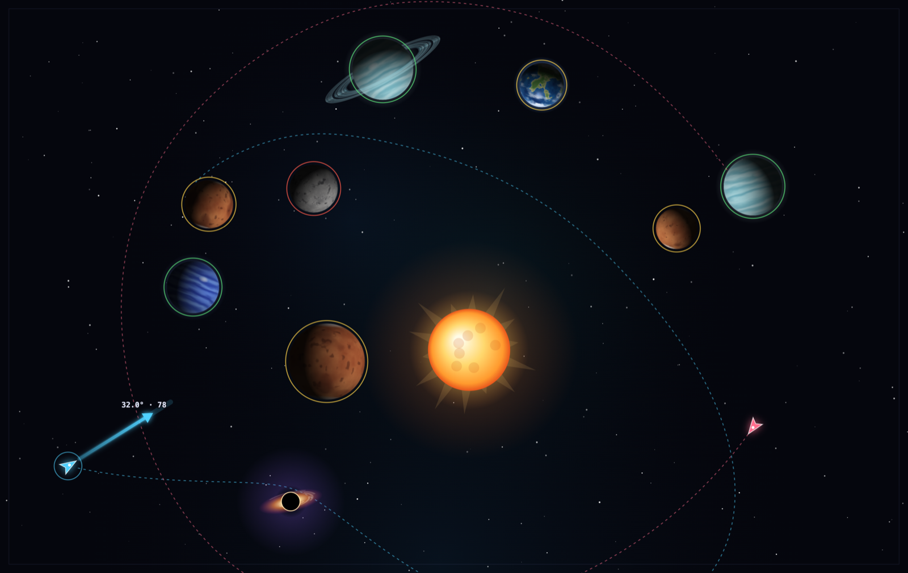
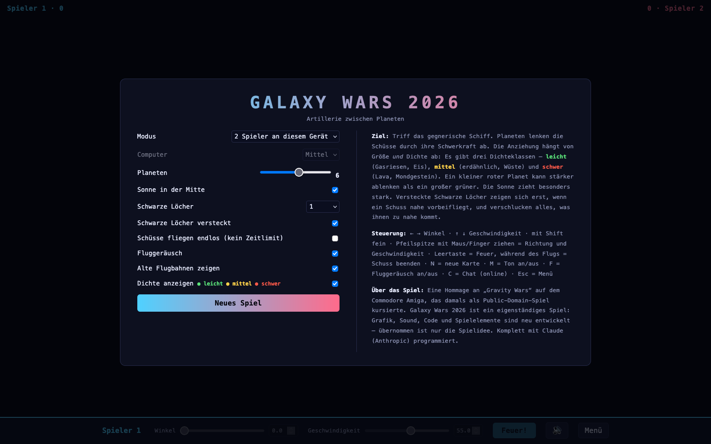

# Galaxy Wars 2026

Ein rundenbasiertes Artillerie-Duell im Weltraum: Zwei Raumschiffe beschießen sich quer durch ein Sonnensystem, und jeder Planet lenkt die Schüsse mit seiner Schwerkraft ab.

> **Hommage an die Amiga-Zeit:** Galaxy Wars 2026 ist inspiriert von **„Gravity Wars“** auf dem Commodore Amiga, das damals als Public-Domain-Spiel kursierte. Es ist ein eigenständiges Spiel: Grafik, Sound, Code und Spielelemente (Sonne, Schwarze Löcher, Dichteklassen, Computer-Gegner, Online-Modus mit Chat) sind neu entwickelt. Aus dem Original ist nichts übernommen – außer natürlich die Spielidee!
>
> **Komplett von/mit [Claude](https://claude.ai) (Anthropic) programmiert:** Browser-Version, Rust-Desktop-Version, Spielserver, Sound-Synthese, Build-Workflows und Dokumentation.

**Online spielen:** [pilotpirx73.github.io/galaxy-wars](https://pilotpirx73.github.io/galaxy-wars/)



<details><summary>Menü ansehen</summary>



</details>

## Zwei Versionen

| | Browser-Version (`web/`) | Desktop-Version (`desktop/`) |
|---|---|---|
| Technik | Eine einzige HTML-Datei, kein Build nötig | Rust mit [macroquad](https://github.com/not-fl3/macroquad) |
| Läuft auf | Jedem Browser, auch Handy und Tablet | macOS, Windows, Linux |
| Starten | `web/index.html` öffnen | App starten (siehe unten) |

Beide Versionen haben dieselben Spielelemente. Die Browser-Version hat zusätzlich einen **Online-Modus** für zwei Spieler an verschiedenen Orten (siehe unten).

## Spielelemente

- **Planeten:** zufällig verteilt. Größere und dichtere ziehen stärker. In der Browser-Version wird jede Oberfläche prozedural berechnet und von der Sonne beleuchtet: erdähnliche Planeten mit Ozeanen, Kontinenten, Polkappen und Wolken, Gasriesen mit Wolkenbändern und Sturmwirbel (geringere Dichte), dazu Wüsten-, Eis-, Lava- und Mondwelten. Manche haben **Ringe**, durch die man hindurchschießen kann.
- **Drei Dichteklassen:** Die Anziehung hängt von Größe *und* Dichte ab (Masse = Radius³ × Dichte). 🟢 leicht (Gasriesen, Eis, Dichte 0,5), 🟡 mittel (erdähnlich, Wüste, 1,0), 🔴 schwer (Lava, Mondgestein, 1,9). Ein farbiger Kreis zeigt die Klasse an und lässt sich im Menü ausschalten.
- **Sonne** in der Mitte, mit besonders starker Schwerkraft.
- **Schwarze Löcher:** klein, aber sehr stark. Wahlweise versteckt: Sie zeigen sich erst, wenn ein Schuss nahe vorbeifliegt, und verschlucken, was ihnen zu nahe kommt.
- **Computer-Gegner** in drei Stufen und mit drei Persönlichkeiten: *Ausgewogen*, *Vorsichtig* (meidet Himmelskörper) und *Trickser* (liebt Schleuderbahnen). Er rechnet Hunderte Probeschüsse im Kopf durch, verzieht den ersten Schuss absichtlich und schießt sich dann systematisch ein. Versteckte Schwarze Löcher kennt er auch nicht.
- **Endlos-Modus:** Schüsse fliegen ohne Zeitlimit, bis sie treffen oder du sie beendest.
- **Alte Flugbahnen** bleiben gestrichelt sichtbar, damit man nachkorrigieren kann.
- **Sound:** Alle Klänge werden im Programm erzeugt. Das Fluggeräusch lässt sich separat abschalten.

## Steuerung

| Taste | Funktion |
|---|---|
| ← / → | Winkel |
| ↑ / ↓ | Geschwindigkeit |
| Shift | fein einstellen |
| Pfeilspitze mit Maus/Finger ziehen | Richtung und Geschwindigkeit |
| Leertaste / Enter | Feuer, während des Flugs: Schuss beenden |
| N | neue Karte |
| M | Ton an/aus |
| F | Fluggeräusch an/aus |
| C | Chat öffnen (Online-Modus) |
| Esc | Menü |

## Desktop-Version bauen

Voraussetzung: [Rust](https://rustup.rs).

```sh
cd desktop
cargo run --release
```

**macOS-App** (`Galaxy Wars.app`, per Doppelklick startbar):

```sh
cd desktop
./build-mac-app.sh
```

Ist zusätzlich das Intel-Ziel installiert (`rustup target add x86_64-apple-darwin`), entsteht eine Universal-App für Apple-Silicon- und Intel-Macs.

**Linux** braucht vorher einige Systembibliotheken, zum Beispiel unter Debian/Ubuntu:

```sh
sudo apt install libx11-dev libxi-dev libgl1-mesa-dev libasound2-dev
```

### Fertige Downloads

Wird ein Versions-Tag gepusht (z. B. `v0.1.0`), baut GitHub Actions automatisch Versionen für macOS, Windows und Linux und hängt sie an ein Release an:

```sh
git tag v0.1.0
git push origin v0.1.0
```

Die Programme sind nicht bei Apple bzw. Microsoft signiert. Beim ersten Start warnt das System deshalb. Unter macOS hilft Rechtsklick → „Öffnen“, unter Windows „Weitere Informationen“ → „Trotzdem ausführen“.

## Online-Modus: über das Internet gegeneinander spielen

Im Modus **„Online gegen Freund“** erstellt einer ein Spiel und bekommt einen vierstelligen Code bzw. einen Einladungslink, der andere tritt damit bei. Pro Zug werden nur die exakten Startwerte des Schusses übertragen. Beide Browser berechnen die Flugbahn dann selbst und kommen bit-genau auf dasselbe Ergebnis. Bei kurzen Verbindungsabbrüchen verbindet sich das Spiel automatisch neu. Über den **💬-Chat** (Taste C) könnt ihr euch während des Spiels Nachrichten schreiben. Der Server speichert dabei nichts, er leitet die Nachrichten nur weiter.

Dafür braucht es den kleinen Spielserver in `server/` (Node.js). Er liefert das Spiel aus und leitet die Züge weiter.

- **Auf einer Synology:** Schritt-für-Schritt-Anleitung in [docs/synology.md](docs/synology.md). Dort steht auch, wie du das Erstellen von Online-Spielen mit einem Passwort schützt und dich per Push-Nachricht über Besucher informieren lässt. Ein fertiges Docker-Image baut GitHub automatisch: `ghcr.io/pilotpirx73/galaxy-wars`.
- **Lokal ausprobieren:**

  ```sh
  cd server
  npm install
  npm start        # dann http://localhost:8080 öffnen
  ```

## Browser-Version auf GitHub Pages

Der Workflow `pages.yml` veröffentlicht `web/` auf GitHub Pages: [pilotpirx73.github.io/galaxy-wars](https://pilotpirx73.github.io/galaxy-wars/). Dort funktionieren alle Modi außer dem Online-Modus, weil GitHub Pages keinen Spielserver betreiben kann. Dafür einmalig im Repository unter *Settings → Pages* als Quelle **GitHub Actions** auswählen.

## Lizenz

[MIT](LICENSE)
